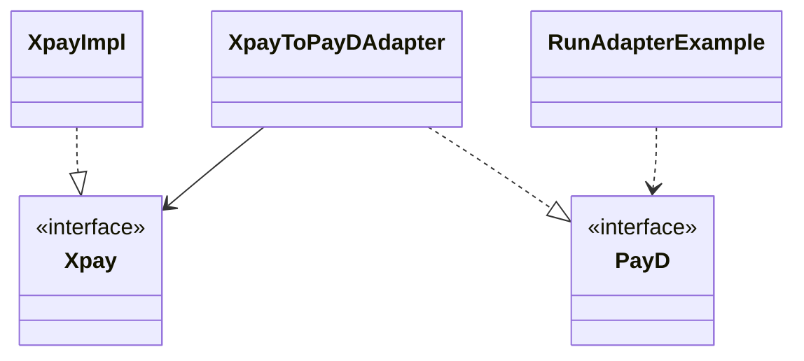
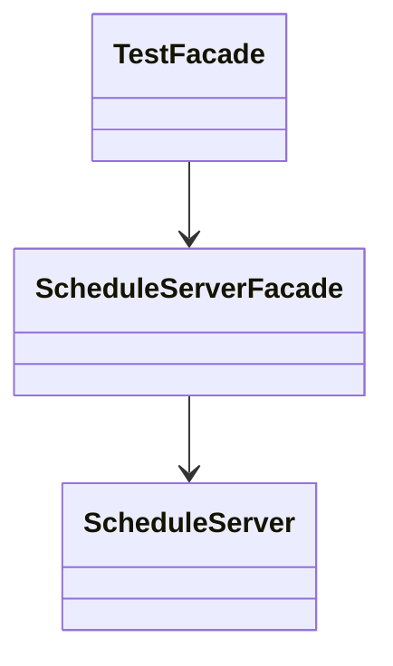
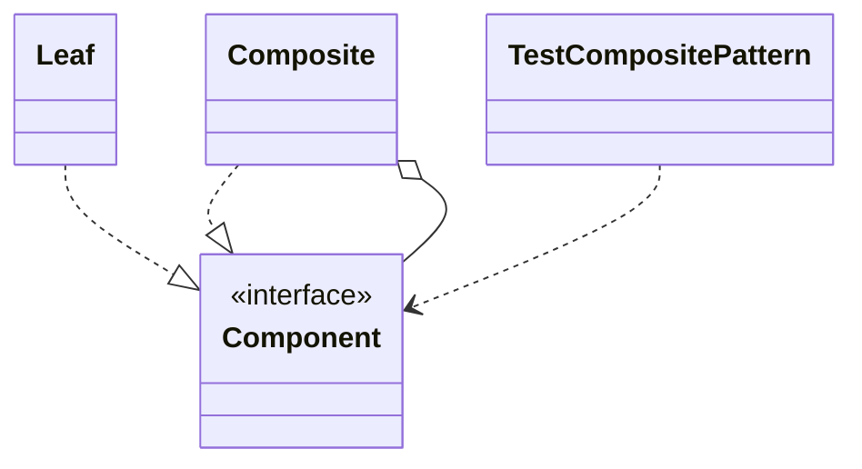
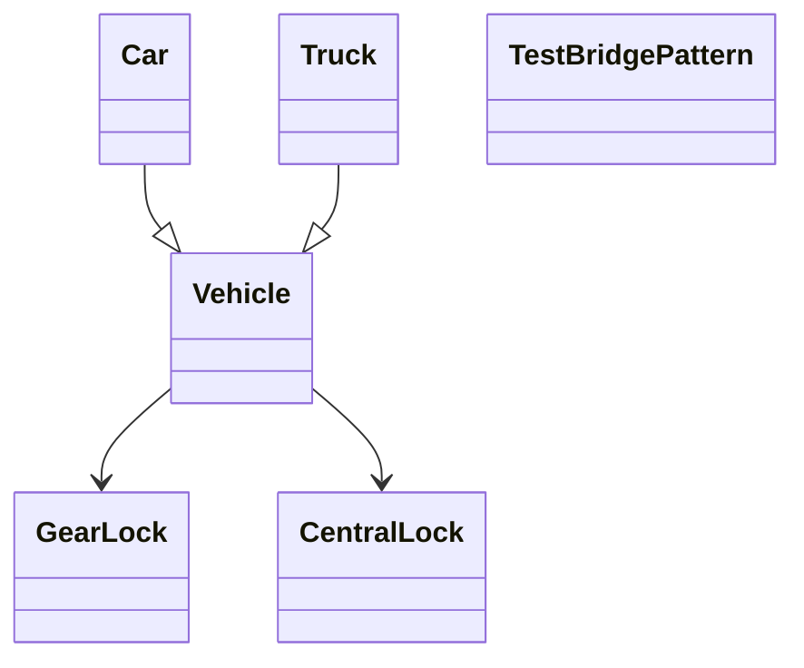
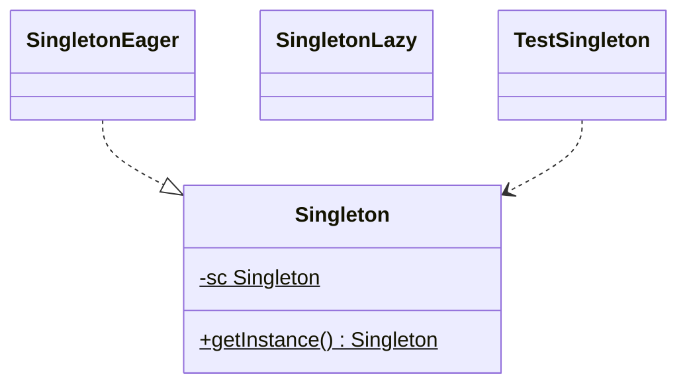

# BÁO CÁO THỰC HÀNH MẪU THIẾT KẾ (DESIGN PATTERNS)

**Môn:** Đặc tả phần mềm  
**Họ và tên:** *[Điền họ tên]*  
**Lớp:** *[Điền lớp]*  
**Ngày nộp:** *[Điền ngày]*

---

## Ngôn ngữ & môi trường test

| Hạng mục | Chi tiết |
|----------|----------|
| **Ngôn ngữ** | **Java** (mã nguồn `.java`, package `com.javacodegeeks.patterns...`) |
| **IDE thực hành** | **BlueJ** (theo tài liệu `HuongdancaidatBlueJ.doc` trong folder) |
| **Nguồn project** | `DesignPatterns_Code/MauThietKe/*.zip` (đã giải nén tại `DesignPatterns_Code/_extract/`) |
| **JDK** | Java 8 trở lên (BlueJ 5.x thường đi kèm JDK hoặc trỏ tới JDK đã cài) |

**Lưu ý về số lượng mẫu:** Trong folder có **23** file zip mẫu. Báo cáo này trình bày **18 mẫu đầu** đúng thứ tự *Kế hoạch Thực hành* (Buổi 11 → Buổi 15, dừng ở **Strategy**). **Phụ lục** cuối file hướng dẫn thêm 5 mẫu: Command, Interpreter, Decorator, Iterator, Visitor.

---

## Các bước chung — mở project & chạy trên BlueJ

1. **Cài đặt:** Tải BlueJ tại [https://www.bluej.org](https://www.bluej.org). Cài xong, mở BlueJ → **Help → About** để xác nhận JDK.
2. **Giải nén:** Với mỗi mẫu, giải nén file zip tương ứng trong `MauThietKe` (hoặc dùng thư mục `_extract` đã giải nén sẵn).
3. **Mở mã nguồn trong BlueJ:**
   - **Project → Open Non BlueJ...**
   - Chọn thư mục **`src`** của project (ví dụ: `...\AdapterPattern-Project\AdapterPattern\src`).
   - BlueJ quét toàn bộ package con và hiển thị sơ đồ lớp.
4. **Biên dịch:** **Tools → Compile Project** (hoặc phím **Ctrl+K**). Sửa lỗi đỏ (nếu có) trước khi chạy.
5. **Chạy chương trình demo:**
   - Tìm lớp có `public static void main` (tên thường là `Test...`, `Run...`).
   - **Click phải** lên lớp đó trên sơ đồ → **void main(String[] args)**.
   - Cửa sổ **Terminal** phía dưới hiển thị kết quả.
6. **Chụp ảnh cho báo cáo (mỗi mẫu nên có 2–3 ảnh):**
   - Ảnh 1: Sơ đồ lớp BlueJ (toàn project hoặc zoom vùng chính).
   - Ảnh 2: Menu chuột phải → `main` đang chạy.
   - Ảnh 3: **Terminal** với output in ra.
   - Windows: **Win + Shift + S** hoặc **PrtSc**; dán vào Word bằng *Insert → Pictures*.

**Trường hợp không có `main` (Singleton):** Tạo lớp `TestSingleton` (mẫu ở mục 5) hoặc dùng **Object Bench** gọi `Singleton.getInstance()`.

**Trường hợp zip có nhiều project con (Proxy):** Chỉ mở **một** thư mục `src` được ghi trong bảng từng mẫu.

---

## Mục lục

1. [Adapter](#1-adapter-mẫu-cấu-trúc)  
2. [Facade](#2-facade-mẫu-cấu-trúc)  
3. [Composite](#3-composite-mẫu-cấu-trúc)  
4. [Bridge](#4-bridge-mẫu-cấu-trúc)  
5. [Singleton](#5-singleton-mẫu-khởi-tạo)  
6. [Observer](#6-observer-mẫu-hành-vi)  
7. [Mediator](#7-mediator-mẫu-hành-vi)  
8. [Proxy (Protection)](#8-proxy-protection-mẫu-cấu-trúc)  
9. [Chain of Responsibility](#9-chain-of-responsibility-mẫu-hành-vi)  
10. [Flyweight](#10-flyweight-mẫu-cấu-trúc)  
11. [Builder](#11-builder-mẫu-khởi-tạo)  
12. [Prototype](#12-prototype-mẫu-khởi-tạo)  
13. [Factory Method](#13-factory-method-mẫu-khởi-tạo)  
14. [Abstract Factory](#14-abstract-factory-mẫu-khởi-tạo)  
15. [Memento](#15-memento-mẫu-hành-vi)  
16. [Template Method](#16-template-method-mẫu-hành-vi)  
17. [State](#17-state-mẫu-hành-vi)  
18. [Strategy](#18-strategy-mẫu-hành-vi)  

**Phụ lục:** Command, Interpreter, Decorator, Iterator, Visitor  

---

## 1. Adapter (Mẫu cấu trúc)

### Bài toán (theo kế hoạch & demo)

Hệ thống thanh toán cũ **XPay** tách **Họ** và **Tên**; API mới **PayD** chỉ có **Họ tên** chung. Cần **Adapter** để client dùng PayD vẫn hoạt động với dữ liệu XPay.

### Sơ đồ lớp (khái niệm)



### Project & lớp chạy BlueJ

| Mục | Giá trị |
|-----|---------|
| Zip | `AdapterPattern-Project.zip` |
| Thư mục `src` | `...\AdapterPattern-Project\AdapterPattern\src` |
| Lớp `main` | `com.javacodegeeks.patterns.adapterpattern.site.RunAdapterExample` |

### Các bước test BlueJ

1. Open Non BlueJ → chọn `AdapterPattern\src` → Compile.  
2. Click phải `RunAdapterExample` → **void main(String[] args)**.  
3. Terminal in: tên chủ thẻ, số thẻ, hạn, CVV, số tiền (đã chuyển qua PayD).

### Giao diện kết quả (chèn ảnh)

*[Ảnh 1: Sơ đồ lớp BlueJ — Adapter]*  
*[Ảnh 2: Terminal — output RunAdapterExample]*

---

## 2. Facade (Mẫu cấu trúc)

### Bài toán

Máy chủ lịch/cơ sở dữ liệu phức tạp; cần **Façade** để người dùng **start/stop** phiên làm việc (mặc định DB) qua một giao diện đơn giản.

### Sơ đồ lớp (khái niệm)



### Project & lớp chạy BlueJ

| Mục | Giá trị |
|-----|---------|
| Zip | `FacadePattern-Project.zip` |
| Thư mục `src` | `...\FacadePattern-Project\FacadePattern\src` |
| Lớp `main` | `TestFacade` (package `facadepattern`) |

### Các bước test BlueJ

1. Mở `FacadePattern\src` → Compile.  
2. Chạy **main** của `TestFacade`.  
3. Quan sát dòng *Start working...*, *After work done...* và log start/stop server qua facade.

### Giao diện kết quả

*[Ảnh: BlueJ + Terminal TestFacade]*

---

## 3. Composite (Mẫu cấu trúc)

### Bài toán (kế hoạch)

**Liên lạc nhóm:** một **cá nhân** có một địa chỉ; **nhóm** là danh sách địa chỉ con (cá nhân hoặc nhóm). Gửi thư tới một địa chỉ (cá nhân hoặc cả nhóm).

### Sơ đồ lớp (khái niệm)



### Project & lớp chạy BlueJ

| Mục | Giá trị |
|-----|---------|
| Zip | `CompositePattern-Project.zip` |
| Thư mục `src` | `...\CompositePattern-Project\CompositePattern\src` |
| Lớp `main` | `TestCompositePattern` |

### Các bước test BlueJ

1. Mở `CompositePattern\src` → Compile → **main** `TestCompositePattern`.  
2. Chụp cây composite trên sơ đồ lớp và output gửi thư.

### Giao diện kết quả

*[Ảnh BlueJ + Terminal]*

---

## 4. Bridge (Mẫu cấu trúc)

### Bài toán (kế hoạch)

Mở rộng **ô tô tả** và thêm **khóa trung tâm / khóa bánh răng**; tách **abstraction** (xe) và **implementor** (khóa).

### Sơ đồ lớp (khái niệm)



### Project & lớp chạy BlueJ

| Zip | `BridgePattern-Project.zip` |
| `src` | `...\BridgePattern\src` |
| `main` | `TestBridgePattern` |

### Các bước test BlueJ

Compile → **main** `TestBridgePattern` → chụp output minh họa xe + loại khóa.

---

## 5. Singleton (Mẫu khởi tạo)

### Bài toán (kế hoạch)

Chỉ **một** đối tượng kết nối CSDL cho ứng dụng (tạo nhiều instance tốn kém).

### Sơ đồ lớp (khái niệm)



### Project BlueJ

| Zip | `SingletonPattern-Project.zip` |
| `src` | `...\SingletonPattern\src` |

**Lưu ý:** Project gốc **không có** lớp `main`. Làm một trong hai cách:

**Cách A — Thêm lớp test (khuyến nghị cho báo cáo):**

1. Trong BlueJ: **Edit → Add Class** → đặt tên `TestSingleton`.  
2. Dán nội dung:

```java
package com.javacodegeeks.patterns.singletonpattern;

public class TestSingleton {
    public static void main(String[] args) {
        Singleton a = Singleton.getInstance();
        Singleton b = Singleton.getInstance();
        System.out.println("a == b: " + (a == b));
        System.out.println("a: " + a);
        System.out.println("b: " + b);
    }
}
```

3. Compile → **main** `TestSingleton` → Terminal phải in `a == b: true`.

**Cách B — Object Bench:** Click phải `Singleton` → **getInstance()** → gọi hai lần, so sánh tham chiếu trên bench.

### Giao diện kết quả

*[Ảnh: TestSingleton Terminal hoặc Object Bench]*

---

## 6. Observer (Mẫu hành vi)

### Bài toán (kế hoạch)

**Học phần** (Subject) gửi thông báo text; **sinh viên** đăng ký/nhận thông báo (ví dụ điểm thi). Demo mẫu: bình luận trận đấu → SMS user.

### Project & lớp chạy BlueJ

| Zip | `ObserverPattern-Lesson-7.zip` |
| `src` | `...\ObserverPattern\src` |
| `main` | `TestObserver` (hoặc `Test`) |

### Các bước test BlueJ

Compile → **main** `TestObserver` → xem subscribe/unsubscribe và thông báo in ra khi `setDesc`.

---

## 7. Mediator (Mẫu hành vi)

### Bài toán (kế hoạch)

Thêm **cảm biến cân** quần áo để tính mức nước giặt; cập nhật trao đổi qua **Mediator** (máy giặt).

### Project & lớp chạy BlueJ

| Zip | `MediatorPattern-Project.zip` |
| `src` | `...\MediatorPattern\src` |
| `main` | `TestMediator` |

Compile → **main** `TestMediator` → chụp Terminal.

---

## 8. Proxy (Protection) (Mẫu cấu trúc)

### Bài toán (kế hoạch)

**Báo cáo doanh thu** chỉ **Owner** được xem; **Employee** bị từ chối qua **Protection Proxy**.

### Project & lớp chạy BlueJ

| Zip | `ProxyPattern-Project.zip` |
| `src` | **`...\PizzaCoReportGeneratorRemoteProtectionProxy\src`** (không mở VirtualProxy) |
| `main` | `com.javacodegeeks.patterns.proxypattern.protectionproxy.TestProtectionProxy` |

### Các bước test BlueJ

1. Open Non BlueJ → chọn đúng thư mục `PizzaCoReportGeneratorRemoteProtectionProxy\src`.  
2. **main** `TestProtectionProxy`.  
3. Terminal: *For owner:* có nội dung báo cáo; *For employee:* thông báo không có quyền.

### Giao diện kết quả

*[Ảnh: output Owner vs Employee]*

---

## 9. Chain of Responsibility (Mẫu hành vi)

### Bài toán (kế hoạch)

**Một cửa:** yêu cầu vào hàng đợi, truyền qua các bộ phận; bộ phận xử lý nếu đúng trách nhiệm, không thì chuyển tiếp.

| Zip | `ChainofResponsibility-Project.zip` |
| `src` | `...\ChainofResponsibility\src` |
| `main` | `TestChainofResponsibility` |

---

## 10. Flyweight (Mẫu cấu trúc)

### Bài toán (kế hoạch)

Thêm nền tảng **Python**; client dịch code Python **2 lần** (tái sử dụng flyweight).

| Zip | `Flyweight-Pattern-Project.zip` |
| `src` | `...\Flyweight Pattern\src` *(có dấu cách trong tên thư mục)* |
| `main` | `TestFlyweight` |

---

## 11. Builder (Mẫu khởi tạo)

### Bài toán (kế hoạch)

Xây **website môn học** phức tạp (đề cương, bài giảng, TH, bài tập, đánh giá) bằng Builder.

| Zip | `Builder-Pattern-Project.zip` |
| `src` | `...\Builder Pattern\src` |
| `main` | `TestBuilderPattern` |

---

## 12. Prototype (Mẫu khởi tạo)

### Bài toán (kế hoạch)

**Đăng ký học phần:** clone danh sách học phần mặc định của lớp (deep clone, HashTable quyền truy cập).

| Zip | `PrototypePattern-Project.zip` |
| `src` | `...\PrototypePattern\src` |
| `main` | `TestPrototypePattern` |

*Bài bổ sung GV:* xem thêm code trong `CodeBosung/Prototype/`.

---

## 13. Factory Method (Mẫu khởi tạo)

### Bài toán (kế hoạch)

Sinh viên nộp báo cáo nhiều loại (trắc nghiệm, code, luận); mỗi loại chấm khác nhau → **Factory Method**.

| Zip | `FactoryMethodPattern-Project.zip` |
| `src` | `...\FactoryMethodPattern\src` |
| `main` | `TestFactoryMethodPattern` |

---

## 14. Abstract Factory (Mẫu khởi tạo)

### Bài toán (kế hoạch)

Mở rộng đánh giá báo cáo **theo từng học phần/môn** khác nhau.

| Zip | `AbstractFactoryPattern-Project.zip` |
| `src` | `...\AbstractFactoryPattern\src` |
| `main` | `TestAbstractFactoryPattern` |

---

## 15. Memento (Mẫu hành vi)

### Bài toán (kế hoạch)

Lập trình viên lưu **các phương án code** đã thử để **quay lại** khi cần.

| Zip | `MementoDesignPattern-Project.zip` |
| `src` | `...\MementoDesignPattern\src` |
| `main` | `TestMementoPattern` |

---

## 16. Template Method (Mẫu hành vi)

### Bài toán (kế hoạch)

Khung **Form nhập 1 bản ghi**: kết nối DB → xác thực → phiên → mở bảng → insert → commit → đóng.

| Zip | `TemplatePattern-Project.zip` |
| `src` | `...\TemplatePattern\src` |
| `main` | `TestTemplatePattern` |

---

## 17. State (Mẫu hành vi)

### Bài toán (kế hoạch)

Robot nấu ăn thêm trạng thái **Warm**; chuyển Cook ↔ Warm ↔ Off (Warm không walk).

| Zip | `StatePattern-Project.zip` |
| `src` | `...\StatePattern\src` |
| `main` | `TestStatePattern` |

*Sau khi sửa code theo đề:* Compile lại → chạy **main** → chụp các chuyển trạng thái in ra.

---

## 18. Strategy (Mẫu hành vi)

### Bài toán (kế hoạch)

Ba chiến lược thiết kế: **top-down**, **bottom-up**, **kết hợp**; đội chọn strategy **động**.

| Zip | `StrategyPattern-Project.zip` |
| `src` | `...\StrategyPattern\src` |
| `main` | `TestStrategyPattern` |

---

# Phụ lục — 5 mẫu còn lại trong folder (19–23)

Nếu giảng viên yêu cầu đủ 23 mẫu trong `MauThietKe`, bổ sung các mục sau (cùng quy trình BlueJ):

| STT | Mẫu | Zip | Thư mục `src` | Lớp `main` |
|-----|-----|-----|---------------|------------|
| 19 | Command | `CommandPattern-Project.zip` | `CommandDesignPattern\src` | `TestCommandPattern` |
| 20 | Interpreter | `InterpreterPattern-Project.zip` | `InterpreterPattern\src` | `TestInterpreterPattern` |
| 21 | Decorator | `DecoratorPattern-Project.zip` | `DecoratorPattern\src` | `TestDecoratorPattern` |
| 22 | Iterator | `IteratorPattern-Project.zip` | `IteratorDesignPattern\src` | `TestIteratorPattern` |
| 23 | Visitor | `VisitorPattern-Project.zip` | `VisitorPattern\src` | `TestVisitorPattern` |

**Interpreter bổ sung (chia, lũy thừa):** dùng thêm `DesignPatterns_Code/CodeBosung/Interpreter/` — mở folder đó trong BlueJ (có `package.bluej` trong SearchEngine; Interpreter là các file `.java` riêng, mở thư mục `CodeBosung/Interpreter`).

---

## Bảng tra nhanh — đường dẫn gốc trên máy bạn

Thay `[ROOT]` bằng:

`C:\Users\Dell\Downloads\AAAAADacta2026\AAAAADacta2026\DesignPatterns_Code\_extract`

| # | Mẫu | Mở BlueJ tại (thư mục `src`) |
|---|-----|------------------------------|
| 1 | Adapter | `[ROOT]\AdapterPattern-Project\AdapterPattern\src` |
| 2 | Facade | `[ROOT]\FacadePattern-Project\FacadePattern\src` |
| 3 | Composite | `[ROOT]\CompositePattern-Project\CompositePattern\src` |
| 4 | Bridge | `[ROOT]\BridgePattern-Project\BridgePattern\src` |
| 5 | Singleton | `[ROOT]\SingletonPattern-Project\SingletonPattern\src` |
| 6 | Observer | `[ROOT]\ObserverPattern-Lesson-7\ObserverPattern\src` |
| 7 | Mediator | `[ROOT]\MediatorPattern-Project\MediatorPattern\src` |
| 8 | Proxy | `[ROOT]\ProxyPattern-Project\PizzaCoReportGeneratorRemoteProtectionProxy\src` |
| 9 | Chain | `[ROOT]\ChainofResponsibility-Project\ChainofResponsibility\src` |
| 10 | Flyweight | `[ROOT]\Flyweight-Pattern-Project\Flyweight Pattern\src` |
| 11 | Builder | `[ROOT]\Builder-Pattern-Project\Builder Pattern\src` |
| 12 | Prototype | `[ROOT]\PrototypePattern-Project\PrototypePattern\src` |
| 13 | Factory Method | `[ROOT]\FactoryMethodPattern-Project\FactoryMethodPattern\src` |
| 14 | Abstract Factory | `[ROOT]\AbstractFactoryPattern-Project\AbstractFactoryPattern\src` |
| 15 | Memento | `[ROOT]\MementoDesignPattern-Project\MementoDesignPattern\src` |
| 16 | Template | `[ROOT]\TemplatePattern-Project\TemplatePattern\src` |
| 17 | State | `[ROOT]\StatePattern-Project\StatePattern\src` |
| 18 | Strategy | `[ROOT]\StrategyPattern-Project\StrategyPattern\src` |

---

## Gợi ý nộp báo cáo Word/PDF

1. Copy nội dung file này vào Word.  
2. Thay *[Điền họ tên]*, *[Điền lớp]*.  
3. Với **mỗi mẫu 1–18**: chèn 2–3 ảnh chụp BlueJ vào chỗ *[Ảnh...]*.  
4. (Tuỳ yêu cầu GV) Bổ sung mô tả **chỉnh sửa code** theo đề từng buổi trong *Kế hoạch Thực hành*.  
5. In hoặc xuất PDF (~10 trang nghiệm thu nếu chỉ 9 mẫu; ~15–25 trang nếu đủ 18 mẫu có ảnh).

---

*Báo cáo khung — sinh viên hoàn thiện ảnh màn hình sau khi chạy BlueJ trên máy cá nhân.*
